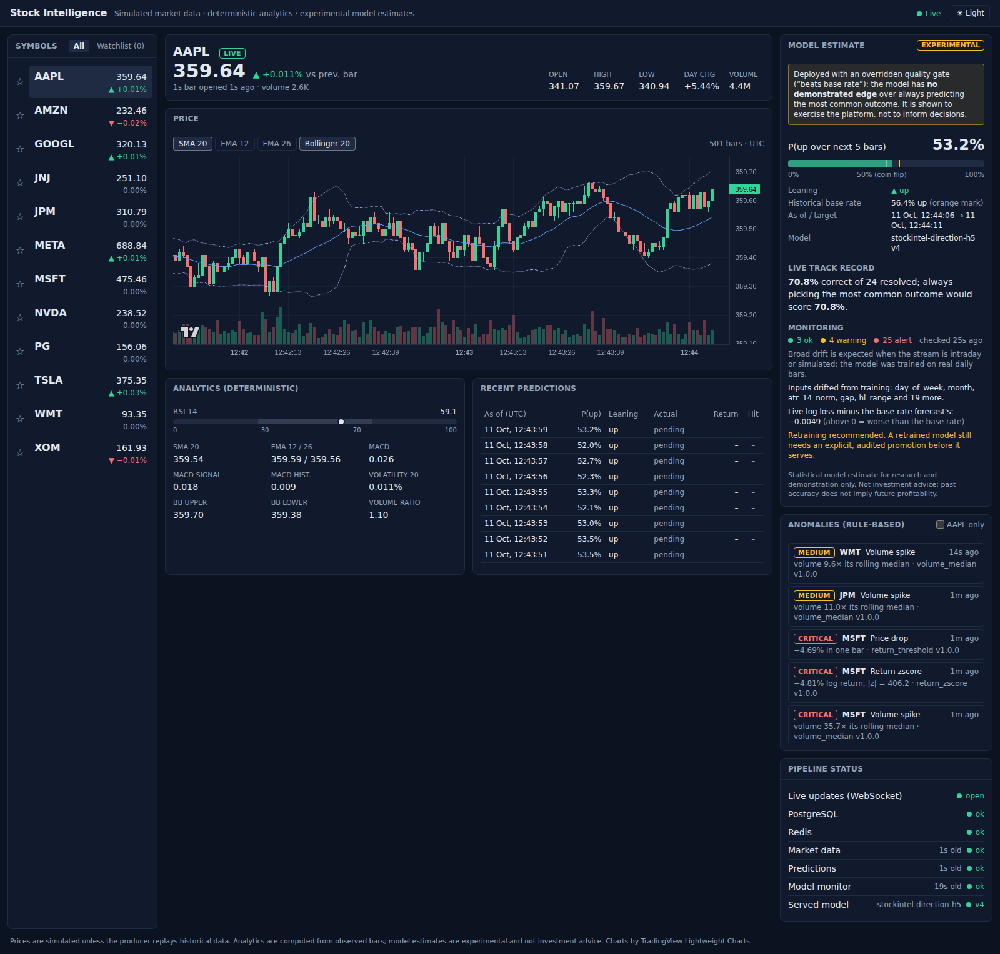
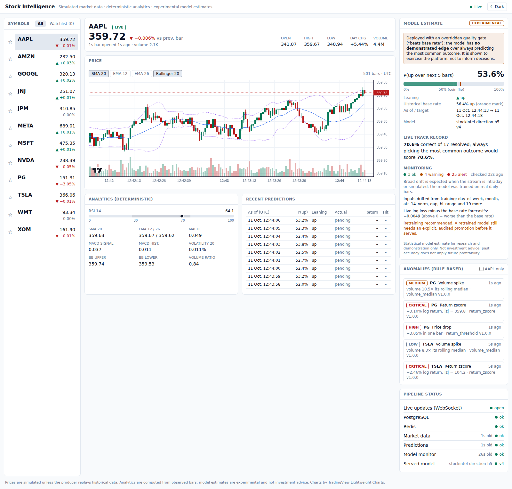
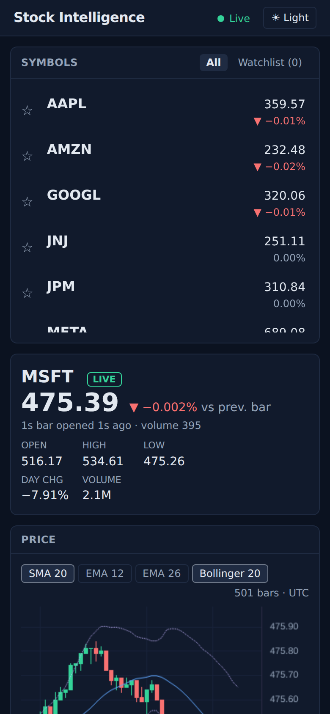
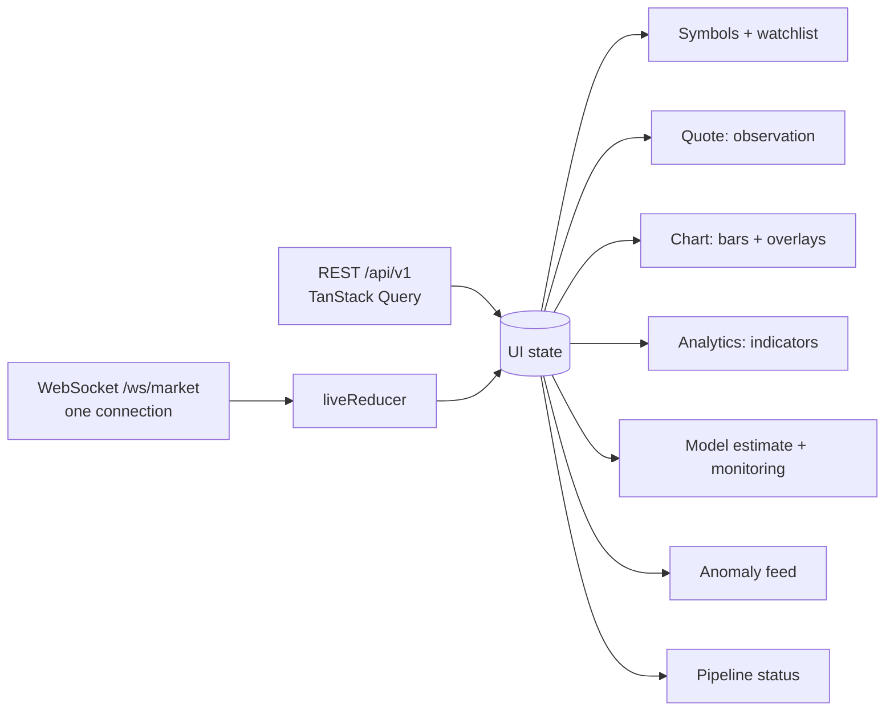
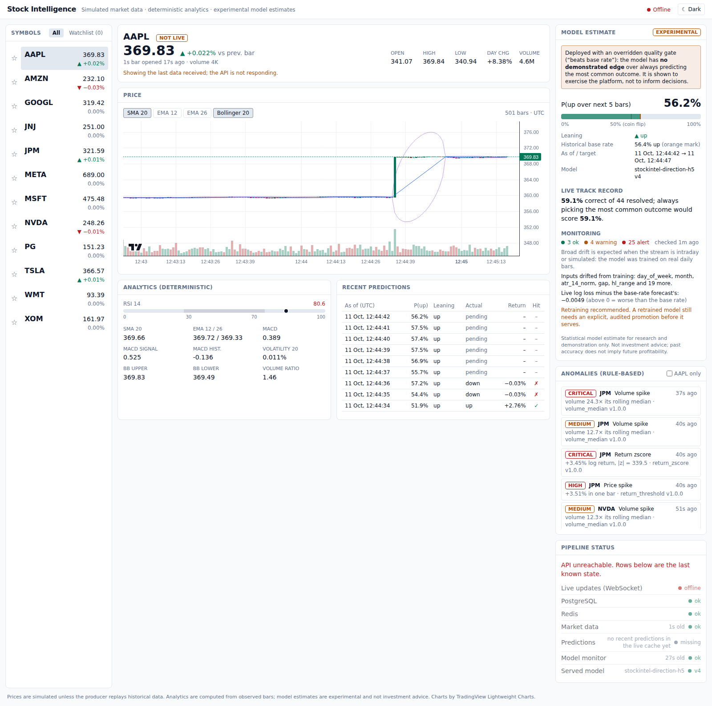

# Dashboard (`apps/frontend`)

A single-page React app that shows live market data, deterministic analytics,
rule-based anomalies and the experimental model, and is explicit about which
is which and about how much (little) the model can be trusted.



| Light theme | Phone (390 px) |
| --- | --- |
|  |  |

Screenshots are from the local demo feed (simulated 1-second bars), the
production build served by nginx, and model version 4 promoted with an
overridden quality gate. They are captured with Playwright; see "Manual QA"
below.

## Stack

| Concern | Choice | Why |
| --- | --- | --- |
| Build / dev server | Vite 7, TypeScript 5.9 (strict, `noUncheckedIndexedAccess`) | SPA with no server rendering needs; fast HMR; one static bundle |
| UI | React 19, Tailwind CSS 4 | Utility classes over a small set of semantic colour tokens (`--sx-*`) that switch with the theme |
| Server state | TanStack Query 5 | Caching, polling, retry, keep-last-data on errors |
| Live data | Native WebSocket (`/ws/market`) | The API already throttles and coalesces; no extra client library |
| Charts | TradingView Lightweight Charts 5 | Canvas candlesticks for thousands of bars; attribution shown in the chart and footer |
| Tests | Vitest 5, Testing Library, jsdom | Component behaviour, not snapshots |
| Lint / format | ESLint 9 (`typescript-eslint` strict, type-checked), Prettier | |

## Layout and data flow



* **One WebSocket** subscribed to every listed symbol (max 50). Bars and
  predictions keep only the newest per symbol, and an out-of-order message
  never replaces a newer one. Anomalies are a de-duplicated feed capped at
  100. Reconnects back off exponentially (1 s to 30 s, with jitter), and 45 s
  without any frame (the server sends a heartbeat every 15 s) counts as a
  dead connection.
* **REST** loads history once per symbol and interval (the live bar is then
  merged in), and polls the slower things: quotes (15 s), the selected
  symbol's detail (10 s), predictions with outcomes (30 s), pipeline status
  (10 s), and model and monitoring (60 s).
* The **selected symbol is in the URL** (`#/AAPL`), so views can be bookmarked.
* **Same origin.** In development Vite proxies `/api` and `/ws` to the API.
  In Compose, nginx serves the build and proxies them, so the browser never
  needs CORS. The API still checks the WebSocket `Origin` against
  `API_CORS_ORIGINS`. The QA run hit that check (403) before the nginx origin
  was added to the list.

## Keeping information honest

The API separates observation, analytics, anomalies and predictions; the UI
keeps them apart visually as well:

* **Quote**: the observed bar only, with a `live` / `fresh` / `stale` /
  `not live` badge. `not live` is shown whenever the WebSocket is down, even
  if a recent bar is cached.
* **Analytics (deterministic)**: indicators computed by the stream processor,
  with RSI drawn against its 30/70 bands.
* **Anomalies (rule-based)**: each item names its detector and version, and
  describes the value in that detector's own units (one-bar move, log return
  with |z|, or volume as a multiple of its rolling median).
* **Model estimate**, labelled **experimental**:
  * P(up) is drawn as a gauge with the 50% line *and* the historical base rate
    (56.4% of weeks were up), so a 53% "up" visibly reads as below the base
    rate, not as a signal.
  * When the deployed version overrode a quality gate, the panel says so in
    words, from the promotion audit log: *no demonstrated edge* over always
    predicting the most common outcome.
  * The live track record always sits next to its baseline: the hit rate of
    resolved predictions vs. the score of always picking the most common
    realised direction.
  * Monitoring shows ok, warning and alert counts, the drifted inputs, and
    log loss vs. the base-rate forecast. When drift is broad it adds that this
    is expected when serving intraday or simulated bars to a daily model.
  * The disclaimer from the API is shown under every estimate.
* **Pipeline status**: the WebSocket, both stores, the freshness of market
  data, predictions and the monitor, and the served model version.

## Degradation

| Failure | What the dashboard does |
| --- | --- |
| WebSocket drops | Header shows `Reconnecting` then `Offline`; the quote badge becomes `not live`; it reconnects with backoff and re-subscribes |
| API unreachable | Last data stays on screen with "Showing the last data received"; the pipeline rows are dimmed and marked as the last known state |
| Inference down | The estimate disappears with an explanation; pipeline status shows predictions as missing or stale; market data keeps flowing |
| No model promoted | "No fresh estimate" and "Served model: none"; everything else works |
| Monitor not run yet | "The model monitor has not reported yet" |



## Accessibility

Direction is never shown by colour alone: there is always an arrow (▲/▼), a
sign (+/−, with a true minus sign), or a word. Gauges are `role="meter"` with
values. Tabs, toggle buttons and the watchlist stars expose
`aria-selected` / `aria-pressed` / `aria-current`. Live regions announce new
anomalies and connection changes politely. Colours meet WCAG AA contrast for
text in both themes (for example `#047857` on white, `#34d399` on `#111a2c`).
Up/down colours are green and red; the arrows carry the meaning for
colour-blind users. The layout collapses to one column below 1024 px.

## Running

```bash
make dev              # full stack incl. the dashboard on http://localhost:8080
# or, for UI work with hot reload (API on :8000 must be running):
make frontend-install
make frontend-dev     # http://localhost:5173
# without Kafka: live simulated data straight into Postgres/Redis
make demo-feed        # needs the API's stores and an inference service
make frontend-check   # typecheck + lint + format check + tests
```

`VITE_API_URL` points the app at another API origin (the default is the same
origin). `VITE_API_PROXY_TARGET` changes the dev proxy target.

## Tests

28 tests across 9 files (`npm test`):

* pure logic: the live reducer (newest-wins, de-duplication, cap), reconnect
  backoff, merging history with live bars, the track record against its
  majority baseline, newest-estimate selection, number formatting;
* components: the model panel (experimental label, base-rate marker,
  overridden-gate warning, missing-estimate state, monitoring summary), the
  anomaly feed (units, filtering, selection), pipeline status (stale, missing
  and last-known states), the symbol list (live prices, direction text,
  watchlist toggle);
* the whole app with mocked `fetch`, WebSocket and chart library: initial
  load, live updates applied from WebSocket frames, and keeping the last quote
  when the API starts failing.

## Manual QA checklist

Run on 2026-10-11 against the production build behind nginx (proxying to the
API), the demo feed (12 symbols, 1-second bars), local PostgreSQL 16 and
Redis 7, inference serving version 4, Chromium (Playwright), at 1600×1000
and 390×844.

| Check | Result |
| --- | --- |
| First load selects the first symbol; `#/NVDA` deep link selects NVDA | pass |
| Prices, quote and chart update live; header shows `Live` | pass |
| Overlay toggles (SMA 20, EMA 12/26, Bollinger) switch state; default SMA 20 + Bollinger visible in screenshots | pass |
| Watchlist star adds and removes; the watchlist tab filters | pass |
| Anomaly click selects the symbol; "only selected" filters | pass |
| Dark/light toggle switches the theme class and chart colours; choice persists across a reload | pass |
| Phone width: one column, symbol list scrolls, session stats wrap | pass (after fixing truncated "Day chg") |
| Stop inference: estimate goes away, predictions shown as missing, market data continues | pass |
| Stop API: `Offline`, `not live` badge, last data kept, pipeline marked last known | pass (after two fixes, below) |
| Restart API and inference: reconnects, all stages `ok` within ~45 s | pass |
| Browser console: no errors | pass (after the locale fix, below) |

Issues found during QA and fixed:

1. With the API down, the quote was replaced by an error even though
   TanStack Query still had the data. It now keeps the data and adds a
   notice; there is a test for it.
2. The quote badge said `live` while the WebSocket was offline.
3. Lightweight Charts threw `Invalid language tag: en-US@posix` in a browser
   whose locale came from a POSIX environment; the chart locale is now set
   explicitly.
4. The chart read its colours before the theme class was applied, which gave
   light grid lines in dark mode on first load. The theme is now applied
   before the first render.
5. Changes that round to 0.00% showed an up/down arrow; direction now follows
   the displayed value.
6. Pipeline status said "no predictions yet" when the live cache had simply
   expired them; it now says "no recent predictions in the live cache".

## Limitations

* No authentication; the watchlist uses the API's default user.
* The chart loads the latest 500 bars; older history (keyset pagination in
  the API) is not wired to scrolling yet.
* No end-to-end browser tests in CI yet (the Playwright QA above was run by
  hand); CI runs the component tests and the build, not a browser.
* The production bundle is about 460 kB (147 kB gzipped), most of it the chart
  library and React; no code splitting.
