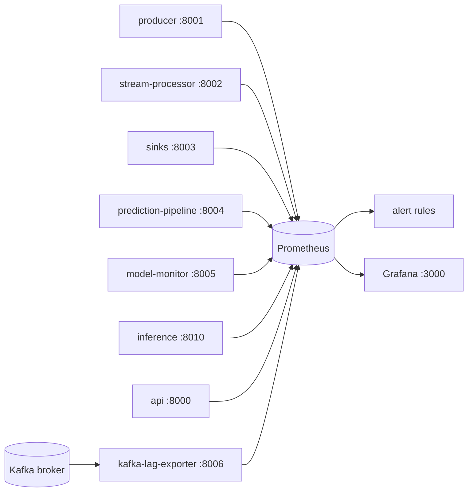

# Observability

Metrics-first: every service exposes Prometheus metrics, Prometheus evaluates
alert rules, Grafana shows dashboards provisioned from code. Logs are
structured JSON (see `shared.observability.logs`); there is no tracing.

## What is scraped

`infrastructure/prometheus/prometheus.yml` has one job per service
(`stream-processor`, `inference` and `api` use DNS service discovery so
`--scale` works). Metric families are prefixed `sip_` by component:
`producer`, `stream`, `sink`, `pipeline`, `inference`, `api`, `monitor`,
`kafka`.

## Kafka lag exporter

Consumers already export their own lag (`sip_stream_consumer_lag`,
`sip_pipeline_consumer_lag`), but a dead consumer cannot report, and the sinks
export none. `shared/observability/kafka_lag.py` asks the broker instead (it
runs from the sinks image) and exports `sip_kafka_group_lag`,
`sip_kafka_group_committed_offset` and `sip_kafka_topic_end_offset` for the
groups `stream-processor`, `persistence`, `cache` and `prediction-pipeline`
(`LAG_EXPORTER_GROUPS` to change). A partition the group never committed
counts everything still retained as lag. Series for removed partitions are
dropped. The consumer-reported gauges stay on the Kafka dashboard as a
cross-check.

A purpose-built exporter such as `kafka-lag-exporter` or `kminion` would be the
usual choice for a larger deployment; a small module was preferable here
to another image to pin and operate.

## Dashboards

Generated by `scripts/gen_dashboards.py` (`make dashboards`) into
`infrastructure/grafana/dashboards/`, provisioned read-only into the folder
"Stock Intelligence": **Pipeline**, **Kafka consumer lag**, **API**,
**Model and monitoring**. A unit test fails if the committed JSON differs from
the generator, and another if any panel or alert references a metric the code
does not export.

## Alerts

`infrastructure/prometheus/rules/alerts.yml`, 18 rules in five groups.
Severities: `critical` (data or service is down), `warning` (degraded),
`info` (context).

| Alert | Fires when |
| --- | --- |
| TargetDown | any scrape target is down for 2 min |
| MarketDataStalled | no Kafka-acknowledged event for 2 min |
| ProducerDeliveryFailures / ProducerBackpressure | delivery failures; local queue full for 5 min |
| ConsumerLagHigh | a group's lag stays above 10 000 messages for 5 min |
| ConsumerLagNotDraining | lag above 1 000 and no offsets committed for 10 min (stuck, not slow) |
| LagExporterBlind | the exporter cannot read the broker (lag alerts untrustworthy) |
| DeadLetteredMessages | anything reached the DLQ in 10 min |
| StreamProcessorErrors | `error`/`invalid` outcomes for 5 min |
| SinkWritesSlow | p99 batch write above 5 s |
| ApiHighErrorRate / ApiSlow | 5xx above 5%; p95 above 1 s |
| InferenceUnavailable / ModelLoadFailing | 503s (no usable model); a model failed to load |
| PredictionsSkipped | ready bars got no prediction for 10 min |
| ModelMonitorNotRunning | no successful monitor cycle in 30 min |
| ModelPerformanceAlert | live performance status is `alert` for 10 min |
| BroadInputDrift (info) | 10 or more inputs are in drift alert; expected when serving simulated or intraday bars to the daily model |

Thresholds are starting points for the demo load, not tuned values; there is
no production traffic to tune them against. Retune them from measured
baselines (Phase 12 documents what could be measured).

### Testing the rules

`make prometheus-test` runs `promtool check config`, `check rules` and
`test rules`. The unit tests (`infrastructure/prometheus/tests/alerts_test.yml`)
feed synthetic series and assert both that alerts fire with the right labels
and annotations and that healthy or draining series stay quiet. The same suite
runs from pytest when `promtool` is on `PATH` (it is skipped otherwise). The
dashboard queries were also parsed with `promtool check rules` (wrapped as
recording rules); Grafana itself has not been run in this environment.

## Not verified here

The Docker stack was not run where this was built: the scrape config, the
compose service for the exporter and the Grafana provisioning are validated
syntactically (promtool, pytest, JSON structure) but not against live
containers. `KafkaOffsetSource` is exercised only through a fake; run
`make dev` and open Prometheus `/targets` and the Kafka dashboard to confirm.
Alerting has no receiver (no Alertmanager): rules are visible in Prometheus
only. Adding Alertmanager routes is a deployment decision.
